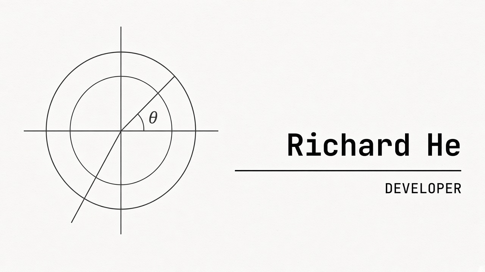

B.A. Computer Science and Mathematics @ University of Virginia | Research Assistant @ UVA Live Robotics Lab | Student Developer @ theCourseForum

  <a href="https://www.linkedin.com/in/richardhe07">LinkedIn</a> ·
  <a href="https://github.com/richardhe789">GitHub</a>

 

## Tools and Languages

       

    

    

   

## Stats
<!-- 

 -->

 
 

<!-- ## Profile Views

  -->
 

## Currently I'm:
- Researching spoken coordination in **Moving Out** at the UVA Live Robotics Lab, aligning dialogue with player movement and labeling communication
- Building course search, filtering, and a course-guessing game for **theCourseForum** (Django, PostgreSQL, React)
- Shipping **Packed**, an ESP32 and Next.js campus map that scores room density from ambient Wi-Fi packet counts
